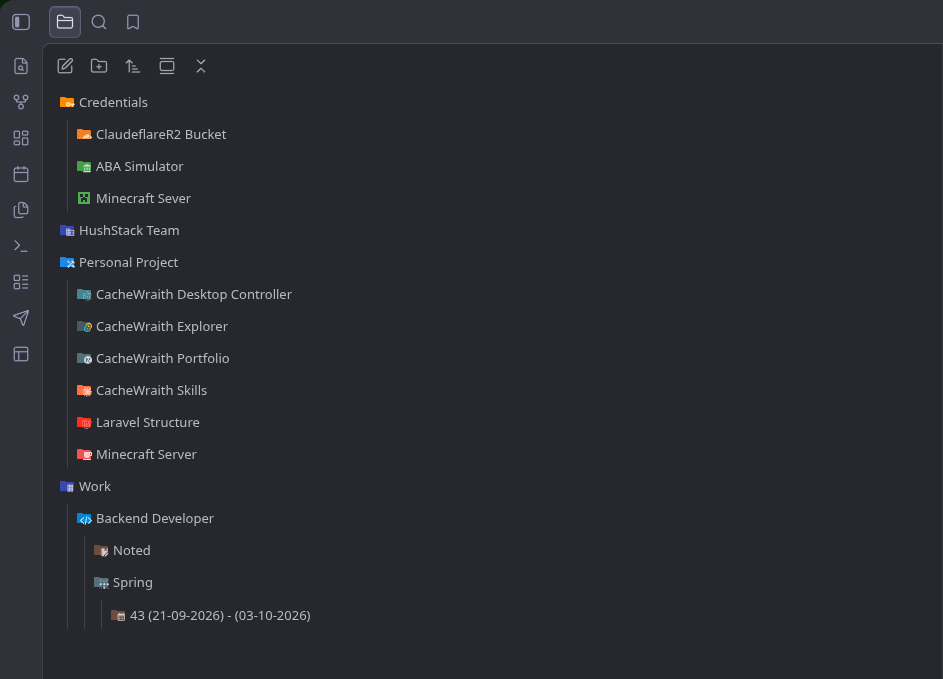
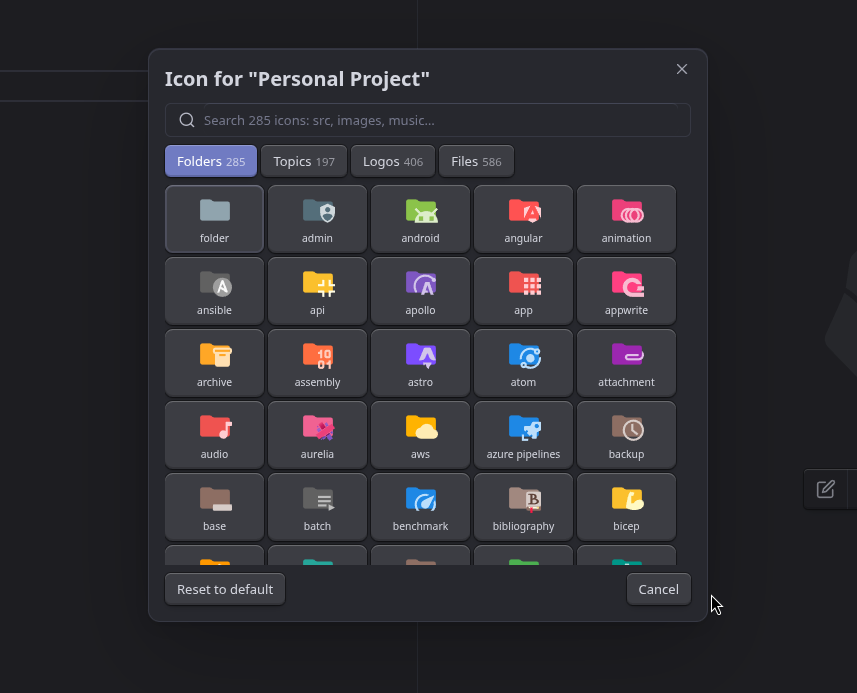
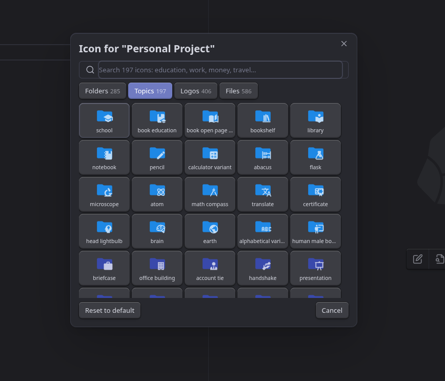
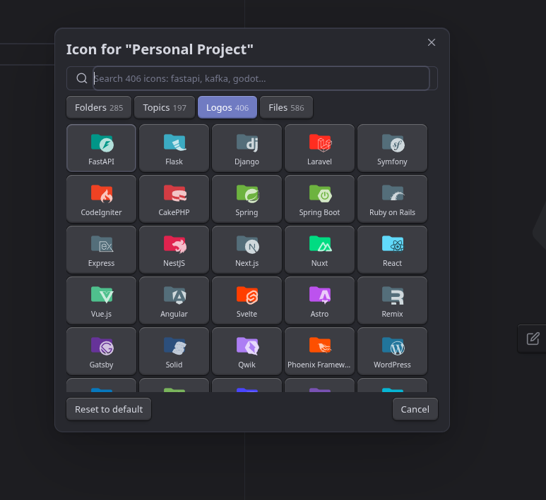
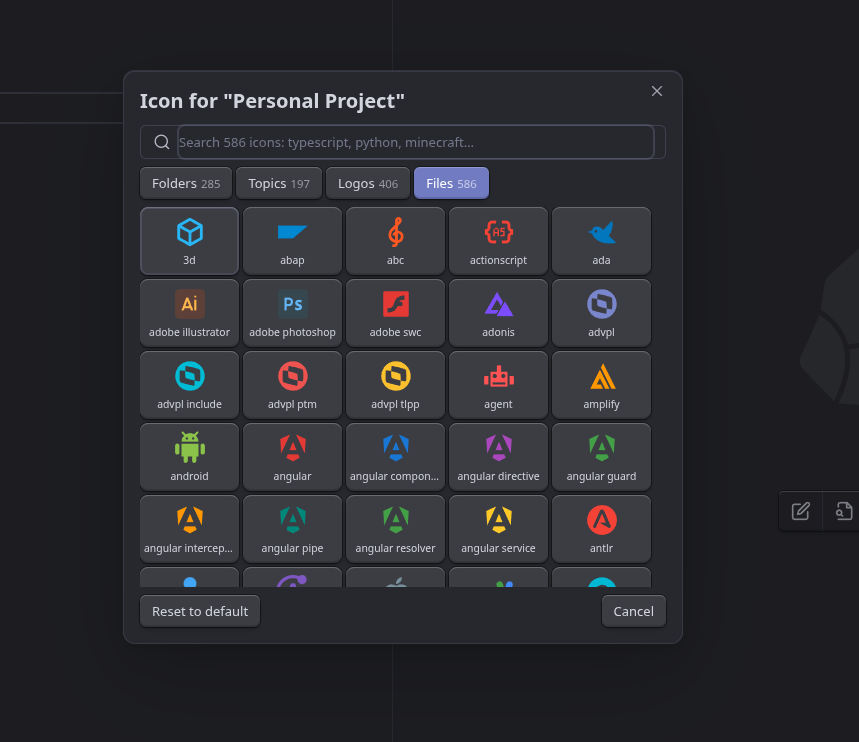

<h1 align="center">Shard Icons</h1>

  <strong>Folder and file icons for the Obsidian file explorer, in the style of VS Code's Material Icon Theme.</strong>

  
  
  

  <a href="https://obsidian.md/plugins?id=shard-icons"><strong>Install in Obsidian</strong></a>
  ·
  <a href="#the-icons">See the icons</a>
  ·
  <a href="#getting-started">Getting started</a>
  ·
  <a href="#faq">FAQ</a>

  

Shard Icons makes a large vault easier to scan. Folders and files get colored, recognizable
icons, so you can find _Projects_, _Finance_ or _Docs_ at a glance instead of reading every name.
Most folders are matched automatically from their name. Anything else takes two clicks to change.

## Features

- **1,474 icons in four sets.** The Material Icon Theme's folder and file icons, everyday topic
  folders, and 406 brand-logo folders, all in one consistent style.
- **Automatic matching.** `src`, `docs`, `images`, `.github`, `work`, `money`, `travel` and
  thousands of other folder names get the right icon with no setup.
- **Fast, forgiving search.** Find an icon by name, by file extension (`md`, `py`, `js`), by
  folder name (`pictures`, `db`) or by everyday word (`note`, `photo`, `password`). Small typos
  still find it, and every tab shows how many icons match.
- **Any icon, anywhere.** A file can use a folder icon or a logo, and a folder can use a file
  icon.
- **Fits your theme.** The icon replaces the one your theme draws instead of sitting next to it,
  and switches to light variants in light mode.
- **Icons in search results too.** Files in the search pane show the same icon as in the file
  explorer.
- **Follows your files.** Renaming or moving a folder keeps its icon, and the icons of everything
  inside it.
- **Private and offline.** No network requests and no telemetry. Every icon ships inside the
  plugin.

## The icons

Right-click any folder or file and choose **Change icon…** to open the picker.

<table>
  <tr>
    <td width="50%" align="center">
      
       <strong>Folders</strong> · 285
       The Material Icon Theme's folder icons: src, docs, tasks, server…
    </td>
    <td width="50%" align="center">
      
       <strong>Topics</strong> · 197
       Everyday folders, each in its own color: education, work, money, travel…
    </td>
  </tr>
  <tr>
    <td width="50%" align="center">
      
       <strong>Logos</strong> · 406
       Folders in a brand's color with its logo: FastAPI, Kafka, Jira, Counter-Strike…
    </td>
    <td width="50%" align="center">
      
       <strong>Files</strong> · 586
       The Material Icon Theme's file icons: TypeScript, Python, Minecraft…
    </td>
  </tr>
</table>

## Getting started

1. Open _Settings → Community plugins → Browse_, search for **Shard Icons**, then select
   _Install_ and _Enable_.
2. That's it: folders with a recognized name get an icon right away.
3. To pick an icon yourself, right-click a folder or file and choose **Change icon…**.

Want file icons as well? Turn on **File icons** in the plugin's settings. Files then get an icon
from their name and extension, just like in VS Code.

<strong>Other ways to install</strong>

**With BRAT**, to get new releases as soon as they are published:

1. Install **BRAT** from Community plugins.
2. _BRAT → Add beta plugin_, then enter `https://github.com/cachewraith/shard-icons`.
3. Enable **Shard Icons** in _Settings → Community plugins_.

**Manually:** download `main.js`, `manifest.json` and `styles.css` from the
[latest release](https://github.com/cachewraith/shard-icons/releases/latest) into
`<your vault>/.obsidian/plugins/shard-icons/`, then reload Obsidian and enable the plugin.

## Using the picker

- **Search** by whatever comes to mind: an icon's name (`python`), a file extension (`md`), a
  folder name (`pictures`) or an everyday word (`photo`). Separate words narrow the results:
  `fast api`.
- **Results are ranked.** Exact names come first, then names that start with what you typed,
  then everything else.
- **All tabs are searched at once.** Each tab shows how many icons match. If the tab you are on
  has none, the picker switches to one that does.
- **Typos are fine.** If nothing matches exactly, the picker shows close matches and tells you
  so. For example, `pyhton` still finds Python.
- **The suggested icon** is the one the theme would have chosen for this name. It is listed
  first and marked `match`.
- **Keyboard:** the arrow keys move through the grid, <kbd>Enter</kbd> picks an icon and
  <kbd>Esc</kbd> closes the picker.

### Other actions

- **Reset an icon:** right-click → _Reset icon to default_, or _Reset to default_ in the picker.
- **Commands:** _Change icon of the active file_ and _Change icon of the active file's folder_
  open the picker for the note you are in. Assign them a hotkey in _Settings → Hotkeys_.
- **Priority:** an icon you chose yourself always wins over an automatic one.

## Settings

| Setting                | Default | Description                                                           |
| ---------------------- | ------- | --------------------------------------------------------------------- |
| Automatic folder icons | On      | Folders without a chosen icon get one matched from their name         |
| File icons             | Off     | Files without a chosen icon get one from their name and extension     |
| Icon size              | 16 px   | Any size from 12 to 28 px                                             |
| Clear all custom icons | —       | Removes every icon you chose. Asks for confirmation; cannot be undone |

## FAQ

**Does it work on mobile?**
Yes. Shard Icons is not desktop-only and uses no desktop-specific APIs.

**Does it slow down large vaults?**
No. The plugin only draws the rows Obsidian's file explorer is showing, and updates them as you
scroll. It never rescans the whole vault.

**Where are my icon choices stored? Do they sync?**
In `.obsidian/plugins/shard-icons/data.json`, alongside your settings. That file syncs with
Obsidian Sync or any other sync tool, so your icons appear on every device.

**What happens if I uninstall or disable the plugin?**
Every icon it added is removed from the explorer straight away, and your notes are never
touched. Your choices stay in `data.json`, so they return if you enable the plugin again.

**An icon shows as a plain folder. Why?**
That icon is not available in this version. It may come from a newer release on another device,
or be a symbol icon from before 0.4.0. Your choice is kept rather than deleted, and appears once
the versions match.

**The icon I want is missing.**
Please [open an issue](https://github.com/cachewraith/shard-icons/issues) with the icon or brand
you have in mind.

## Privacy

Shard Icons makes no network requests and collects no data. It reads only folder and file names,
to match icons, and stores only your settings and icon choices.

## Contributing

Bug reports, ideas and pull requests are welcome. Please
[open an issue](https://github.com/cachewraith/shard-icons/issues) first for larger changes.
Building, testing and releasing are covered in [`docs/development.md`](docs/development.md) and
[`docs/releasing.md`](docs/releasing.md). See [`CHANGELOG.md`](CHANGELOG.md) for what changed in
each release.

## Credits and licenses

Shard Icons is released under the MIT license; see [`LICENSE`](LICENSE). The icons it bundles
come from these projects, under their own licenses:

- **[Material Icon Theme](https://github.com/material-extensions/vscode-material-icon-theme)**:
  MIT, © Philipp Kief and contributors.
  [License](licenses/material-icon-theme-LICENSE.txt)
- **[Simple Icons](https://simpleicons.org)**: CC0-1.0.
  [License](licenses/simple-icons-LICENSE.md)
- **[Material Design Icons](https://pictogrammers.com/library/mdi/)**: Apache-2.0, by
  Pictogrammers. [License](licenses/material-design-icons-LICENSE.txt)

Brand logos are trademarks of their respective owners. The CC0 waiver covers the icon files, not
the marks themselves. See [`licenses/`](licenses/) for the full notices.
